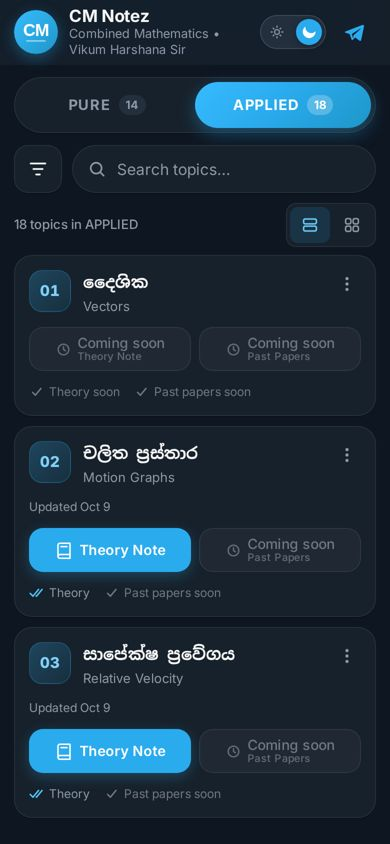
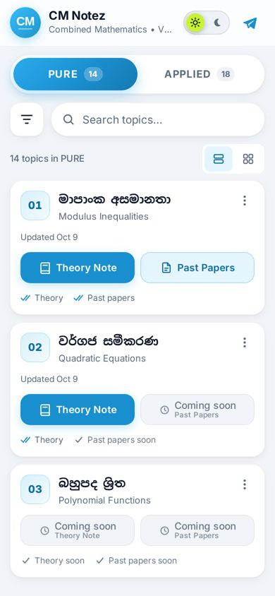

# CM Notez – Combined Mathematics Notes Catalog

A fast, Telegram-style web app that lists every **Combined Mathematics (Sri Lankan A/L)** topic with its **Theory Note** and **Past Papers** links, by **Vikum Harshana Sir**.
It replaces the old Telegraph page and opens from the **“View All Notes”** button under the [CM Notez | VikumHarshana](https://t.me/cmnotez) channel post.

**Live site:** https://sazindux.github.io/cmnotez/

| Dark (default) | Light |
| --- | --- |
|  |  |

- Vanilla HTML + CSS + JS (ES modules). No framework, no build step. The app shell is about 28 KB gzipped.
- The "database" is a single CSV file, [`data/topics.csv`](data/topics.csv), which you can edit right on GitHub.
- PURE / APPLIED tabs (tap or swipe), instant Sinhala + English search, filters, list or grid view, and dark or light theme.
- Installable PWA. It works offline and shows the last saved copy of the notes.

---

## 1. How to add or update a link (no coding needed)

Every topic has two "link spaces": `theory_url` and `pastpaper_url`. If a space is empty, the site shows a grey **“Coming soon”** button.

### From the GitHub website or mobile app
1. Open the repo → **`data`** folder → **`topics.csv`**.
2. Tap the **pencil icon ✏️** (“Edit this file”).
   *(Mobile app: open the file → `…` menu → **Edit file**.)*
3. Find the topic's row, e.g. Polynomial Functions:
   ```
   p03,pure,3,බහුපද ශ්‍රිත,Polynomial Functions,,,FALSE,
   ```
4. Paste the Telegram link into the right spot. Columns are separated by commas:
   ```
   id , category , order , title_si , title_en , theory_url , pastpaper_url , is_new , updated
   ```
   Example: add a theory note **and** past papers, mark it new, and set today's date:
   ```
   p03,pure,3,බහුපද ශ්‍රිත,Polynomial Functions,https://t.me/cmnotez/60,https://t.me/cmnotez/61,TRUE,2026-10-20
   ```
   Only a theory note (past papers stays empty, so there is nothing between the two commas):
   ```
   p03,pure,3,බහුපද ශ්‍රිත,Polynomial Functions,https://t.me/cmnotez/60,,FALSE,2026-10-20
   ```
5. Scroll down → **Commit changes**.
6. The site redeploys automatically in **about 1 minute**. Visitors see the change the next time they open the page or come back to the tab.

> 💡 Get a Telegram post link: long-press the post in the channel → **Copy Post Link**. It looks like `https://t.me/cmnotez/27`.

### Mark a topic as NEW
Set `is_new` to `TRUE` (or back to `FALSE`). The card shows a lime **NEW** pill, and the topic appears under the **New** filter.

### Set the "Updated" date
Put the date in `updated` as `YYYY-MM-DD`, for example `2026-10-20`. The card shows "Updated Oct 20", and the footer's "Last updated" uses the newest date in the file.

### Add a brand-new topic
Add a new line at the end of the file (or anywhere you like; the order comes from the `order` column):
```
p15,pure,15,නව මාතෘකාව,New Topic Name,https://t.me/cmnotez/70,,TRUE,2026-11-01
```
- `id`: must be **unique**. Use `p..` for Pure and `a..` for Applied (e.g. `p15`, `a19`).
- `category`: `pure` or `applied` (lower-case).
- `order`: the position number inside that category (the next number after the last one).

### Remove a topic
Delete its line and commit.

### CSV rules (important ✋)
- **Do not change the first line (header row).** The deploy check fails if it changes.
- If a title contains a **comma**, wrap that field in **double quotes**:
  `a06,applied,6,"කාර්යය, ශක්තිය සහ ජවය","Work, Energy and Power",,,FALSE,`
- If you need a double quote *inside* a quoted field, type it twice: `""`.
- Leave a link field empty (nothing between the commas) when the link isn't ready.
- Only `http://` / `https://` links are accepted. Anything else is ignored for safety.
- Rows without an `id`, without any title, or with a wrong `category` are skipped. A warning is printed in the browser console.

---

## 2. Deployment (GitHub Pages)

The site is served by **GitHub Pages** through a **GitHub Actions** workflow that runs on every push to `main`:

1. It checks that the `topics.csv` header row is unchanged.
2. It copies the site files into `_site/`.
3. It uploads `_site/` and deploys it with `actions/deploy-pages`.

### One-time setup
1. **Workflow file.** The workflow is in [`ci/deploy.yml`](ci/deploy.yml). The AI assistant's GitHub token didn't have the `workflows` permission, so it couldn't create files inside `.github/workflows/`. Activate the workflow once on GitHub:
   - Repo → **Add file → Create new file** → name it `.github/workflows/deploy.yml` → paste the contents of `ci/deploy.yml` → **Commit**.
   - (Optional) delete `ci/deploy.yml` afterwards.
2. **Settings → Pages → Build and deployment → Source: “GitHub Actions”.**
3. Push any change (or run the workflow manually from **Actions → Deploy to GitHub Pages → Run workflow**).

> **Quick alternative (no workflow):** Settings → Pages → Source: **Deploy from a branch** → `main` / `/ (root)`. The site is fully static, so this works too. There is a `.nojekyll` file in the repo so every file is served as-is.

### Caching and updates
- The app keeps the last catalog in `localStorage`, so it shows that copy **instantly** and then refreshes from the network in the background (stale-while-revalidate). The CSV request is cache-busted (`?v=timestamp`).
- The service worker (`sw.js`) precaches the app shell and loads `topics.csv` **network-first** (falling back to the cache when offline).
- **After changing HTML/CSS/JS** (not needed for CSV edits), bump `VERSION` in `sw.js` (e.g. `v1.0.1`) so installed apps pick up the new shell.

---

## 3. Changing colors and design

All colors, radii and timings are CSS variables in **[`css/tokens.css`](css/tokens.css)**:
- `--brand`: Telegram blue accent (`#2AABEE`), used for icons, borders and highlights.
- `--brand-fill` / `--brand-grad`: deeper blue behind white text (buttons, active tab), chosen so white text passes WCAG AA (≥ 4.5:1) contrast.
- `[data-theme="dark"]` and `[data-theme="light"]` blocks: background, surface, text and muted colors for each theme.
- `--accent-lime`: the toggle's sun thumb and the NEW pill.
- `--ease`, `--d-fast`, `--d-med`, `--d-slow`: animation easing and durations.

To replace the logo, overwrite `assets/logo.svg`. Then regenerate the PNG icons in `assets/icons/` (192, 512, maskable 192/512, apple-touch-icon 180, favicon 32) with any SVG→PNG tool.

---

## 4. Features and behaviour

| Feature | Notes |
| --- | --- |
| Tabs | PURE / APPLIED with a sliding indicator, count badges, ← → keys, and swipe left/right on the list |
| Search | Debounced; matches Sinhala + English; case- and extra-space-insensitive; ignores ZWJ/ZWNJ; highlights matches |
| Filters | Bottom sheet (drag down / tap backdrop / Esc to close): All, Has Theory Note, Has Past Papers, Has Both, New, Coming soon (= at least one link missing) |
| Views | 1-column list or 2-column grid (3–4 columns on large screens); choice is remembered |
| Card menu | ⋮ button, long-press, or right-click → Copy Theory link / Copy Past Papers link / Share (Web Share API, clipboard fallback) |
| Deep links | `#pure`, `#applied`, `#search=binomial`, `#applied&search=newton`, `#topic=a05` (scrolls to and highlights a card) |
| Theme | Follows the system on first visit; your choice is saved; animated sun/moon switch |
| Offline | "Offline – showing saved notes" banner; cached catalog is shown |
| Install | A custom, one-time, dismissible "Install" banner (`beforeinstallprompt`) |
| Accessibility | Semantic landmarks, ARIA tabs/switch/dialog, focus trap in sheets, visible focus, 44 px targets, `prefers-reduced-motion` |
| Security | All CSV text is inserted with `textContent`; only http(s) URLs are allowed; links use `rel="noopener noreferrer"` |

### Decisions made
- **Repository name:** the connected repo is `sazindux/cmnotez` (the brief said `cm-notez`). We used the existing repo instead of creating a duplicate, so the site URL is `/cmnotez/`.
- **Contrast:** the pure `#2AABEE` with white text is only 2.6:1, so filled buttons use a deeper `#1A78B8` (4.75:1). `#2AABEE` is still the accent everywhere else.
- **"Coming soon" filter:** shows topics missing *either* link.
- **Fonts:** loaded asynchronously from Google Fonts (`display=swap`) with system fallbacks (Iskoola Pota / Nirmala UI for Sinhala), so text is never blocked.

---

## 5. Project structure

```
cmnotez/
├── index.html              App shell (header, tabs, toolbar, sheets, SVG icon sprite, SEO/OG tags)
├── css/
│   ├── tokens.css          Design tokens – light & dark variables (edit colors here)
│   ├── base.css            Reset, typography, focus, scrollbar, reduced-motion
│   └── components.css      Header, toggle, tabs, search, cards, buttons, skeleton, sheet, toast, FAB
├── js/
│   ├── app.js              Bootstrap, state, events, tabs/swipe, search, filters, sheets, hash, PWA
│   ├── csv.js              Robust CSV parser (quotes, commas, BOM, CRLF, UTF-8)
│   ├── data.js             Fetch (cache-busted), normalize/validate, localStorage cache
│   ├── ui.js               Safe DOM rendering, highlight, skeleton, stagger reveal, toast, ripple
│   └── theme.js            Theme toggle + persistence + system preference
├── data/
│   └── topics.csv          ← The catalog. Edit this to add links.
├── assets/
│   ├── logo.svg            "CM" badge logo (replace any time)
│   └── icons/              PWA / favicon / Open Graph images
├── docs/                   README screenshots (not deployed)
├── manifest.webmanifest    PWA manifest
├── sw.js                   Service worker (shell precache, CSV network-first)
├── ci/deploy.yml           GitHub Pages workflow (copy to .github/workflows/ – see §2)
└── README.md
```

### Run locally
```bash
python3 -m http.server 8080
# open http://localhost:8080
```
(A local server is needed because the app `fetch`es the CSV and uses ES modules.)

---

## 6. Quality checks (done during development)
- 32 topics (14 Pure + 18 Applied) render, all 11 existing links work, and 53 empty slots show “Coming soon”.
- No horizontal scrolling at 360 / 390 / 430 / 768 / 1280 px.
- Lighthouse (mobile, gzip-served): **Performance 97–98, Accessibility 100, Best Practices 100, SEO 100**.
- Works offline after the first visit (service worker + cached CSV).
- Malicious CSV values (`javascript:` URLs, HTML in titles) are neutralised.

Made for A/L Combined Mathematics students 🇱🇰
